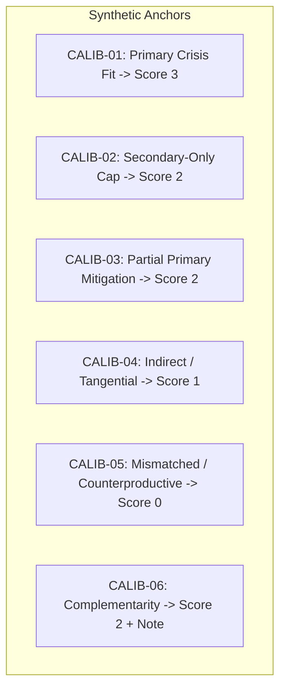

# Benchmark v1.1 Calibration Rubric & Human Reviewer Protocol

**Document Version:** `benchmark-v1.1-calibration-rubric-revised`  
**Status:** Conditional Proposal — Pending Research Methodology Review & Formal Sign-Off  
**Target Benchmark:** Benchmark v1.1 (`S071`–`S130`, 60 Compound-Need Scenarios across Zones Z1–Z10)  
**Preceding Milestones:** 
- [Evaluation Preregistration v1.0](file:///c:/Users/User/Desktop/subsidy/farmer-benefit-ml/research/dataset_research/evaluation_preregistration.md)
- [Benchmark v1.1 Design Proposal](file:///c:/Users/User/Desktop/subsidy/farmer-benefit-ml/research/dataset_research/benchmark_v1.1_design_proposal.md)
- [Benchmark v1.1 Scenario Manifest](file:///c:/Users/User/Desktop/subsidy/farmer-benefit-ml/research/dataset_research/benchmark_v1.1_scenario_manifest.md)
- [Preflight Audit Report](file:///c:/Users/User/Desktop/subsidy/farmer-benefit-ml/reports/benchmark_v1.1_preflight_audit.md)  
- [Scheme Master Registry](file:///c:/Users/User/Desktop/subsidy/farmer-benefit-ml/scheme_database/processed/scheme_master.json)  
**Date:** October 2026  

---

## 1. Executive Summary & Purpose

This document establishes the official **Relevance Scoring Calibration Rubric**, **Annotator Reviewer Protocol**, and **Pre-Annotation Sign-off Gates** for Benchmark v1.1.

In Benchmark v1.0.4-EXP, scenarios featured a single isolated need, which allowed a static 1-to-1 lookup heuristic to attain near-ceiling performance ($0.9818$ mean NDCG@3). Benchmark v1.1 introduces **compound-need farmer profiles** with simultaneous acute crises and secondary operational constraints. 

To evaluate ranking algorithms rigorously without introducing evaluation noise, subjective drift, or target-label conflation, this specification provides:
1. Strict conceptual decoupling between **intrinsic ordinal relevance labels** and **downstream rank positions / NDCG@3 metrics**.
2. An explicit operational definition of **Score 3** (direct resolution of primary crisis is sufficient; secondary-need alignment strengthens the rationale but is not mandatory).
3. The **Primary Crisis Primacy** boundary (secondary-only support is strictly capped at Score 2).
4. Six synthetic training calibration anchors linked directly to statutory scheme records and authoritative documentation.
5. Reviewer workflows for independent E1/E2 evaluation, raw data freezing, agreement computation prior to consensus discussion, and escalation of major disagreements ($|\Delta| \ge 2$).
6. A comprehensive pre-annotation sign-off checklist.

> [!IMPORTANT]
> **Status Notice:**
> Formal human annotation packet generation (`E1_v1.1_blank.csv` and `E2_v1.1_blank.csv`) remains **strictly blocked** until the research team formally inspects and accepts this revised calibration rubric.

---

## 2. Unit of Scoring & Decoupling from Ranking Metrics

### 2.1 The Scoring Unit vs. The Statistical Observation Unit
To maintain methodological precision and avoid data-leakage or degrees-of-freedom errors:

1. **Scoring Unit (Annotation Level):**
   - The individual scoring unit is a single **(Scenario $s$, Candidate Scheme $c$) pair**, where scheme $c$ belongs to **Section A** (`allow_numerical_scoring == True` and `governance_status == "ELIGIBLE"`).
   - Annotators assign an ordinal relevance score $y_{s, c} \in \{0, 1, 2, 3\}$ along with an evidence-based operational rationale.
2. **Statistical Observation Unit (Metric Evaluation Level):**
   - In strict alignment with [Evaluation Preregistration §4.1](file:///c:/Users/User/Desktop/subsidy/farmer-benefit-ml/research/dataset_research/evaluation_preregistration.md#L72-L91), the statistical observation unit for model comparison and hypothesis testing is the **individual farmer scenario query** ($N = 60$).
   - Candidate scheme ratings within a scenario ($K \in [2, 7]$) are correlated and do **not** represent independent degrees of freedom. Statistical tests are computed over scenario-level paired NDCG@3 differences.

### 2.2 Decoupling Relevance Labels from Ranking Positions and NDCG@3
- **Crucial Distinction:** Ordinal relevance scores ($y \in \{0, 1, 2, 3\}$) reflect the **intrinsic operational fit and practical utility** of a scheme for a farmer's specific operational profile.
- Relevance scores must **never be defined in terms of expected rank position** (e.g., "must appear in Top-3 cards"). 
- Ranking metrics (such as NDCG@3 and MRR) evaluate the accuracy of a recommender model's ordering against these frozen ground-truth relevance labels. Conflating label definitions with rank positions creates circularity and distorts evaluation.
- Multiple candidates within the same scenario may independently earn Score 3 if each directly and materially resolves the acute primary crisis through different valid interventions.

### 2.3 Individual Scheme Recommendations vs. Scheme Bundles
- In this benchmark, the recommender system presents an ordered ranking of **individual scheme recommendation cards**.
- **Rule:** The scoring unit is the **individual scheme**, evaluated on its own standalone merits within the context of the farmer profile.
- **Bundle Decision Note:** Recommending **interdependent subsidy bundles** (e.g., co-applying for Krishi Bhagya farm pond + PDMC drip micro-irrigation as an integrated package) represents a distinct research problem requiring package-level utility schemas and combinatorial ranking metrics. It must not be conflated with single-item card ranking.

---

## 3. Four-Level Compound-Need Relevance Rubric

Every candidate scheme presented in Section A must be scored on a 4-point ordinal scale ($0$ to $3$):

```
       [Primary Acute Crisis Resolved] ──────────► Score 3 (High Operational Priority)
                     │
                     ▼ (No)
       [Secondary Need Directly Resolved OR ──────► Score 2 (Secondary Priority / Partial Relief)
        Partial / Incomplete Primary Relief]
                     │
                     ▼ (No)
       [Contextual, Indirect, or Tangential] ────► Score 1 (Marginal Support)
                     │
                     ▼ (No)
       [Mismatched, Blocked, or Counterproductive]► Score 0 (Irrelevant / Misaligned)
```

### Detailed Level Definitions

| Score | Rating Level | Operational Definition | Practical Criteria |
| :---: | :--- | :--- | :--- |
| **3** | **High Priority / Direct Primary Resolution** | Directly and materially addresses the farmer's stated **Primary Acute Crisis** within applicable statutory conditions and operational timing. | • Directly halts the acute crisis (e.g., provides water access for withering crops, replaces a burnt pump).<br>• High practical impact during the current crop season.<br>• **Resolution of the primary crisis is sufficient for Score 3.** Secondary-need alignment strengthens the rationale, but is not mandatory. |
| **2** | **Secondary Priority / Direct Secondary Need or Partial Relief** | Directly resolves an important **Secondary Operational Constraint** without resolving the primary crisis; OR provides material but **incomplete mitigation** of the primary crisis. | • **Secondary-Only Cap:** A scheme that directly resolves a secondary constraint (e.g., seasonal working capital credit or soil diagnostic testing) but leaves the acute primary water/crop crisis unaddressed is **strictly capped at Score 2**.<br>• Partial relief of primary distress (e.g., micro-irrigation to stretch remaining water from a failing borewell). |
| **1** | **Marginal Support / Indirect or Tangential Value** | Technically applicable and statutory criteria satisfied, but provides minor, distant, or tangential practical value in the current operational context. | • Fails to resolve either primary or secondary constraints directly.<br>• Generic advisory, minor off-season assistance, or low immediate impact.<br>• Minimal practical contribution to immediate farm operations or crisis mitigation. |
| **0** | **Irrelevant / Misaligned / Counterproductive** | Despite statutory eligibility, the scheme provides no practical fit, is poorly timed, requires unrequested high capital co-investment, or is foreseeably counterproductive. | • Requires substantial unrequested civil works or debt that exacerbates acute insolvency.<br>• Asset mismatch (e.g., drip subsidy for rainfed broadcast crops where no water source exists).<br>• Foreseeably counterproductive impact on the farmer's operational stability. |

---

## 4. Methodological Invariants & Scoring Safeguards

### 4.1 Primary Crisis Primacy & Secondary Support Capping
- **The Rule:** An intervention addressing only secondary operational constraints cannot receive Score 3, regardless of how effectively it resolves that secondary constraint.
- **Operational Rationale:** When an acute crisis threatens standing crop death or farm insolvency within days (e.g., dry borewell mid-pod-filling), providing secondary input credit or soil testing without water access does not avert catastrophic crop loss. Halting the primary acute crisis is prioritized.

### 4.2 Handling Scheme Complementarity (No Score Inflation)
- In compound-need scenarios, multiple schemes frequently complement each other (e.g., MIDH polyhouse + PDMC drip irrigation).
- **Rule:** Potential complementarity must be recorded in the annotator's **Complementarity Notes field** and must **not** independently inflate an individual scheme's score.
- An individual scheme is scored strictly on what its statutory intervention delivers standalone. Reviewers must not assign a Score 3 to Scheme A on the hypothetical assumption that the farmer will simultaneously receive Scheme B.

### 4.3 Treatment of Upstream Statutory Eligibility
- Reviewers evaluate practical relevance **conditional upon legal eligibility**.
- **Rule on Leaked Ineligibility:** If a scheme appears in Section A that is statutorily barred (e.g., PM-KISAN for a registered constitutional post holder or pure oral tenant without land title):
  - The reviewer must **not** simply downscore it to 0 as an ordinary poor recommendation.
  - The reviewer must flag it as an **Upstream Candidate-Generation/Governance Defect**.
  - A statutory violation indicates a defect in the eligibility engine or governance filter, requiring pipeline inspection rather than label absorption.

---

## 5. Synthetic Training Calibration Anchors

The following six synthetic examples illustrate boundary decisions and rationale standards. These are **calibration fixtures only**, completely independent of benchmark scenarios `S071`–`S130`.



### Anchor 1: Direct Primary Crisis Resolution (Score 3)
- **Profile (`CALIB-01`):** Smallholder in Raichur (Zone 2), 3.0 acres dryland groundnut entering the seasonal crop cycle. The farmer recently drilled a successful borewell with verified discharge, but the parcel is completely off-grid with no electrical infrastructure. The primary acute crisis is the complete absence of pumping machinery and water extraction capability to establish irrigation for the crop season. The secondary constraint is seasonal input working capital.
- **Evaluated Scheme:** `SCH006` (PM-KUSUM Component B — Standalone Solar Agriculture Pump).
- **Scheme Master Link:** [`SCH006` in scheme_master.json](file:///c:/Users/User/Desktop/subsidy/farmer-benefit-ml/scheme_database/processed/scheme_master.json). Mandate: 60% combined subsidy for standalone solar ag pump (up to 7.5 HP) on unenergized off-grid water sources.
- **Statutory Authority:** Ministry of New and Renewable Energy (`pmkusum.mnre.gov.in`).
- **Assigned Score:** **`3` (High Priority)**
- **Operational Rationale:** `SCH006` directly and materially resolves the primary acute crisis by subsidizing a standalone off-grid solar pump on an unenergized borewell, providing the farmer with permanent, grid-independent water lifting capacity for the cropping season. Direct primary relief is sufficient for Score 3; secondary input credit remains unaddressed by this scheme but does not reduce its Score-3 standing.
- **Implementation Runway & Timing Note:** Reviewers must evaluate implementation timelines against the scenario's stated urgency. Capital infrastructure schemes like `SCH006` involve administrative application processing, vendor allocation, and physical site installation by designated state implementing agencies (`pmkusum.mnre.gov.in`). Because official guidelines do not guarantee fixed turnaround times, reviewers must assess implementation lag on a case-by-case basis. When a scenario describes an acute crisis where a standing crop will perish within hours or days, a capital procurement subsidy cannot provide emergency relief and raters must account for that timing infeasibility. In `CALIB-01`, the timing aligns with seasonal crop establishment.
- **Complementarity Note:** *None.*

### Anchor 2: Secondary-Only Support (Score 2 — Capped)
- **Profile (`CALIB-02`):** Same farmer as `CALIB-01` (off-grid unenergized borewell, seasonal water crisis, secondary input cash constraint).
- **Evaluated Scheme:** `SCH008_CENTRAL` (Central KCC-MISS — Concessional Short-Term Crop Loan).
- **Scheme Master Link:** [`SCH008_CENTRAL` in scheme_master.json](file:///c:/Users/User/Desktop/subsidy/farmer-benefit-ml/scheme_database/processed/scheme_master.json). Mandate: Concessional short-term crop loans up to Rs. 3 Lakh at 4% effective interest upon prompt repayment for seasonal operational inputs.
- **Statutory Authority:** Department of Financial Services & MoA&FW (`financialservices.gov.in`).
- **Assigned Score:** **`2` (Secondary Priority / Capped)**
- **Operational Rationale:** `SCH008_CENTRAL` directly resolves the secondary operational constraint by providing up to Rs. 3 Lakh in short-term credit at 4% prompt repayment interest, which can finance seed and fertilizer purchases. However, credit alone cannot extract water from an unenergized borewell without pump machinery. Under the Primary Crisis Primacy rule, secondary-only resolution is strictly capped at Score 2.
- **Complementarity Note:** *High operational synergy if paired with solar pump installation, but evaluated strictly on standalone merits.*

### Anchor 3: Partial Primary Crisis Mitigation (Score 2)
- **Profile (`CALIB-03`):** Farmer in Bagalkote (Zone 3), 4.0 acres horticulture (pomegranate). Groundwater yield dropped from 2.5 inches to 0.75 inches mid-season. Primary acute crisis is insufficient water volume to sustain the orchard canopy. Secondary constraint is high cost of water tanker deliveries.
- **Evaluated Scheme:** `SCH003` (PMKSY-PDMC — Micro Irrigation / Drip System).
- **Scheme Master Link:** [`SCH003` in scheme_master.json](file:///c:/Users/User/Desktop/subsidy/farmer-benefit-ml/scheme_database/processed/scheme_master.json). Mandate: 45–55% capital subsidy for drip/sprinkler installation, capped at 5.0 ha.
- **Statutory Authority:** Ministry of Agriculture and Farmers Welfare (`pmksy.gov.in`).
- **Assigned Score:** **`2` (Partial Primary Relief)**
- **Operational Rationale:** `SCH003` provides capital assistance for precision drip installation, delivering water directly to tree root zones through emitters in accordance with PMKSY-PDMC guidelines (`pmksy.gov.in`). While drip hardware does not create a new water source, precision root-zone delivery minimizes surface conveyance and evaporation losses compared to unlined flood channels, conditionally stretching the remaining 0.75-inch borewell discharge across the orchard canopy subject to the scenario's soil moisture holding capacity and tree water demand. Because it provides material but incomplete relief of the primary water volume shortage, it warrants Score 2.
- **Complementarity Note:** *Highly complementary with in-situ water storage structures (farm pond).*

### Anchor 4: Contextual but Indirect / Tangential Support (Score 1)
- **Profile (`CALIB-04`):** Smallholder in Kolar (Zone 5), 2.8 acres tomato experiencing severe early-blight fungal infection mid-season. Primary acute crisis is crop disease threatening complete harvest wipeout within 7 days. Secondary constraint is lack of high-pressure spraying equipment.
- **Evaluated Scheme:** `SCH009` (Soil Health Card Scheme).
- **Scheme Master Link:** [`SCH009` in scheme_master.json](file:///c:/Users/User/Desktop/subsidy/farmer-benefit-ml/scheme_database/processed/scheme_master.json). Mandate: 100% free statutory soil testing and crop-specific fertilizer recommendations.
- **Statutory Authority:** Department of Agriculture and Cooperation (`soilhealth.dac.gov.in`).
- **Assigned Score:** **`1` (Marginal / Tangential)**
- **Operational Rationale:** `SCH009` is statutory-eligible and universally accessible, providing free soil macro- and micronutrient testing. However, laboratory processing requires 2–4 weeks, offering zero therapeutic relief for an acute fungal outbreak requiring immediate chemical spraying. It provides indirect long-term agronomic value, but marginal immediate relevance in an acute emergency.
- **Complementarity Note:** *Useful post-harvest for soil rehabilitation, not for standing blight control.*

### Anchor 5: Mismatched / Counterproductive Intervention (Score 0)
- **Profile (`CALIB-05`):** Rainfed marginal farmer in Vijayapura (Zone 3), 1.8 acres ragi and bajra, facing severe drought and total crop failure. The farmer has zero existing irrigation assets, zero water source, and outstanding non-institutional debt at high interest. Primary crisis is acute household distress and lack of income.
- **Evaluated Scheme:** `SCH003` (PMKSY-PDMC — Micro-Irrigation Drip Subsidy).
- **Scheme Master Link:** [`SCH003` in scheme_master.json](file:///c:/Users/User/Desktop/subsidy/farmer-benefit-ml/scheme_database/processed/scheme_master.json).
- **Statutory Authority:** Ministry of Agriculture and Farmers Welfare (`pmksy.gov.in`).
- **Assigned Score:** **`0` (Irrelevant / Mismatched)**
- **Operational Rationale:** Although technically eligible under general landholding criteria, `SCH003` provides a subsidy for drip irrigation hardware that requires a pressurized water source (borewell, open well, or farm pond). The farmer has no water source whatsoever. Recommending drip hardware to a waterless rainfed farmer experiencing drought is practically unviable, requires capital co-investment the farmer lacks, and constitutes a false recommendation.
- **Complementarity Note:** *None.*

### Anchor 6: Complementarity Captured in Notes, Not Score Inflation (Score 2 + Note)
- **Profile (`CALIB-06`):** Farmer in Belagavi (Zone 8), 3.2 acres commercial chilli. The farmer has an open well with adequate water, but suffers from extreme seasonal weed infestation and heavy labor costs, while seeking to install drip fertigation for the upcoming cycle. Primary crisis is weed/labor distress; secondary is precision fertigation transition.
- **Evaluated Scheme:** `SCH003` (PMKSY-PDMC — Drip Irrigation).
- **Scheme Master Link:** [`SCH003` in scheme_master.json](file:///c:/Users/User/Desktop/subsidy/farmer-benefit-ml/scheme_database/processed/scheme_master.json).
- **Statutory Authority:** Ministry of Agriculture and Farmers Welfare (`pmksy.gov.in`).
- **Assigned Score:** **`2` (Secondary Priority)**
- **Operational Rationale:** `SCH003` addresses the secondary need of establishing precision drip lines. It does not resolve the acute standing weed and labor crisis (which requires mechanization or intercultural tools under SMAM, `SCH004`). Although `SCH003` pairs synergistically with future fertigation management, its individual contribution is limited to the secondary need. It is scored 2, not 3.
- **Complementarity Note:** *Strong synergy with SMAM (`SCH004`, `agrimachinery.nic.in`) power weeder and soil testing. Evaluated strictly on standalone contribution.*

---

## 6. Treatment of Section B (Qualitative Review Only)

Section B schemes are quarantined by statutory governance rules and must never be evaluated numerically:

1. **Quarantined Candidates:**
   - `SCH002` (PMFBY): Quarantined pending seasonal Insurance Unit (IU) notification circulars.
   - Provisional Corporation Schemes (`SCH008_KA_COOP`, `SCH010_VALMIKI`, `SCH010_DEVARAJ_URS`, `SCH010_KMDC`): Quarantined pending active fiscal year Government Orders.
   - Pure Tenant Credit Documentation (`SCH008_CENTRAL` for oral lessees): Quarantined pending local JLG / lease documentation verification.
2. **Cognitive Blinding & Order of Presentation:**
   - To prevent raters' Section A scoring from being biased by Section B policies (e.g., assuming PMFBY will compensate for crop loss when rating cash support), **Section B candidates must be displayed in a physically separate section or after Section A evaluation is complete**.
3. **Qualitative Only:** Raters provide operational annotations (e.g., verifying whether the local PACS has sanctioned cooperative credit limits or whether the crop is notified under RWBCIS), but **never assign 0–3 relevance scores**.

---

## 7. Reviewer Protocol for Expert Annotators (E1 & E2)

```
[Blinded Dossier Distribution]
           │
           ├──────────────────────────┐
           ▼                          ▼
     [Expert E1]                [Expert E2]
   Independent Scoring        Independent Scoring
   Evidence Rationales        Evidence Rationales
   Complementarity Notes      Complementarity Notes
           │                          │
           └──────────┬───────────────┘
                      ▼
     [Raw Data Archival & Lock]
     (E1_raw.csv & E2_raw.csv preserved immutably)
                      │
                      ▼
     [Inter-Rater Reliability Assessment]
     (Computed strictly on raw ratings:
      Weighted Kappa >= 0.61, Krippendorff's Alpha >= 0.67)
                      │
                      ▼
         [Disagreement Resolution]
         • |E1 - E2| = 1: Structured Consensus Discussion
         • |E1 - E2| >= 2: Mandatory Formal Adjudication Panel
                      │
                      ▼
     [Separate Consensus Ground Truth Freeze]
     (consensus_labels_final.csv with audit trail)
```

### Protocol Guidelines
1. **Strict Independence:** Raters E1 and E2 must complete their evaluations independently without communication, shared draft reviews, or access to heuristic/AI baseline predictions.
2. **Mandatory Audit Fields:** For every candidate scheme in Section A, the rater must provide:
   - `relevance_score` $\in \{0, 1, 2, 3\}$
   - `relevance_rationale`: 1–3 sentences justifying the score relative to the scenario's primary crisis, secondary constraints, and asset context.
   - `complementarity_notes`: (Optional) Observations on bundle synergies with other eligible schemes.
3. **Raw Ratings Archival & Reliability Calculation Gate:**
   - Raw submissions from E1 and E2 must be **frozen unchanged** upon intake into `data/annotations/benchmark_v1.1/raw/`.
   - **Inter-rater reliability statistics must be calculated strictly on these original independent ratings before any consensus discussion or adjudication takes place.**
   - Pre-registered thresholds:
     - **Quadratic Weighted Cohen's Kappa:** $\kappa_w \ge 0.610$
     - **Ordinal Krippendorff's Alpha:** $\alpha_{\text{ord}} \ge 0.670$
4. **Disagreement Resolution & Consensus Ledger:**
   - **Exact Agreement ($|E1 - E2| = 0$):** Retain agreed score.
   - **Adjacent Disagreements ($|E1 - E2| = 1$):** Reconciled via structured reviewer discussion; if consensus is reached, the agreed score and reconciled rationale are logged.
   - **Mandatory Adjudication ($|E1 - E2| \ge 2$):** Any candidate where raters diverge by 2 or 3 points must be escalated to a formal adjudication panel.
   - **Separate Consensus Ledger:** Adjudicated and consensus ratings must be saved in a **separate final consensus document** (`data/annotations/benchmark_v1.1/consensus_labels_final.csv`). The raw submissions from E1 and E2 remain unaltered to preserve complete provenance.

---

## 8. Pre-Annotation Research Sign-Off Checklist

Before releasing `E1_v1.1_blank.csv` and `E2_v1.1_blank.csv` to annotators, the research team must complete and sign off on the following checklist:

- [ ] **Empirical Candidate Distribution Accepted:**
  - The observed Section A candidate pool (mean `4.48`, range `2`–`7` schemes) is recognized as a reflection of catalog capacity (11 non-provisional schemes) and statutory constraints, rather than an error requiring artificial scheme injection.
- [ ] **Primary & Secondary Coverage Verified:**
  - In all 60 scenarios, the generated Section A candidate set contains at least two genuinely competing schemes addressing either primary crisis relief or secondary constraints.
- [ ] **Section A / Section B Separation Confirmed:**
  - All Section A candidates have `allow_numerical_scoring == True` and `governance_status == "ELIGIBLE"`.
  - All Section B candidates (`PMFBY`, provisional schemes) are score-disabled and placed in qualitative review.
- [ ] **Score 3 Definition Explicitly Resolved:**
  - Direct and material resolution of the primary acute crisis is established as **sufficient** for Score 3.
  - Secondary-need alignment strengthens the rationale, but is not mandatory for Score 3.
  - Secondary-only support remains strictly capped at Score 2.
- [ ] **Relevance Decoupled from Rank Positions:**
  - Ordinal relevance labels are established as intrinsic operational suitability scores, completely separate from rank positions or NDCG@3 metrics.
- [ ] **Raw Ratings Preservation Mandate:**
  - Inter-rater agreement statistics will be computed strictly on raw, unadjudicated E1 and E2 submissions before any consensus discussions or adjudication. Raw files will remain permanently unaltered.
- [ ] **Preregistered Evaluation Gates Preserved:**
  - Preregistered model acceptance criteria ($\Delta \overline{\text{NDCG@3}} \ge +0.050$, permutation $p < 0.050$, zero zone regressions) remain strictly locked and unmodified.
- [ ] **Statistical & Label Isolation Maintained:**
  - Scenario matrix and candidate sets contain zero prepopulated scores, AI ratings, or consensus labels.

---

*(Artifact prepared under milestone Benchmark v1.1 Scenario Manifest & Preflight Audit for research team review.)*
