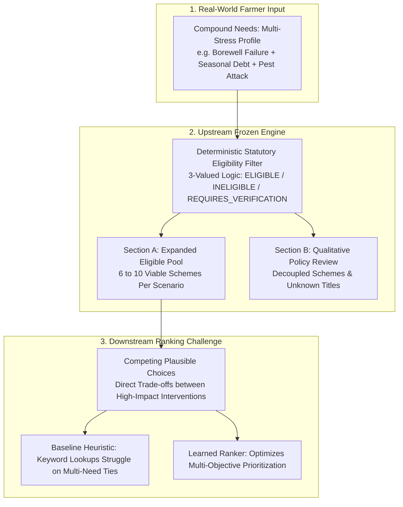

# Benchmark v1.1 Design Proposal: Compound-Need Agricultural Subsidy Ranking Benchmark

**Document Version:** `benchmark-v1.1-proposal-draft`  
**Status:** Pre-Experimental Architecture & Evaluation Specification  
**Predecessor Milestone:** Benchmark `v1.0.4-EXP` Feasibility Audit (`commit 691d6bc`)  
**Target Domain:** Karnataka Agricultural Welfare Subsidy & Benefit Discovery Engine  
**Date:** October 2026  

---

## 1. Executive Context & Evolutionary Rationale

### 1.1 Lessons from Benchmark v1.0.4-EXP
Benchmark `v1.0.4-EXP` successfully established the technical pipeline for deterministic statutory eligibility checking, intake validation, immutable archival, and inter-rater agreement computation. However, the subsequent feasibility audit ([`benchmark_v1.0.4_candidate_set_audit.md`](file:///c:/Users/User/Desktop/subsidy/farmer-benefit-ml/research/dataset_research/benchmark_v1.0.4_candidate_set_audit.md)) uncovered a fundamental structural limitation in the evaluation design:

1. **Candidate Pool Compression:** Upstream eligibility filtering compressed the 16-scheme master catalog down to an average of **$4.72$ candidates per scenario**.
2. **Single-Need Artificiality:** Scenarios were constructed around a single isolated `immediate_need` (e.g. `SOLAR_PUMP_INSTALLATION` or `FARM_MECHANIZATION`).
3. **The Heuristic Ceiling Effect:** Because each candidate pool contained exactly one scheme matching that single need, a transparent 1-line heuristic achieved a near-ceiling mean NDCG@3 of **$0.9818$**.
4. **Pre-Registration Infeasibility:** At a baseline of $0.9818$, the pre-registered requirement of $\Delta \overline{\text{NDCG@3}} \ge +0.050$ required reaching an NDCG@3 of $1.0318$, which is mathematically impossible.

### 1.2 Purpose of Benchmark v1.1
Benchmark `v1.1` preserves the frozen deterministic statutory engine (`src/eligibility/engine.py` at commit `7724fa7`), but fundamentally transforms the **ranking challenge** by replacing single-need synthetic archetypes with **realistic, multi-dimensional, compound farmer crisis profiles**. 

In Benchmark `v1.1`, the ranking stage encounters genuine clinical trade-offs between multiple viable, eligible schemes competing for top-3 presentation cards.

---

## 2. Structural Design Principles of Benchmark v1.1

### Principle 1: Candidate Space as an Empirical Hypothesis
In production, farmers with diversified operations qualify for multiple concurrent welfare schemes. In Benchmark `v1.1`, candidate sets will be generated **strictly through the frozen statutory eligibility engine** (`src/eligibility/engine.py` at commit `7724fa7`). 

> [!IMPORTANT]
> **Scientific Integrity Guardrail:**
> Candidate set sizes (hypothesized 6–10 schemes) and baseline performance (hypothesized $0.65$–$0.80$ NDCG@3) are **design hypotheses to be empirically measured**, not forced requirements. Eligibility rules must never be altered or relaxed artificially to force a lower baseline score or enlarge candidate sets. The engine runs unchanged.

### Principle 2: Compound Farmer Needs Architecture
Rather than assigning a singular need string, each scenario in `v1.1` features a **primary acute crisis** accompanied by **secondary operational constraints**:

$$\text{Profile Need} = \{\text{Primary Acute Crisis}, \text{Secondary Working Capital}, \text{Infrastructure Barrier}\}$$

### Principle 3: Elimination of Heuristic Target Collusion & Real Clinical Trade-Offs
In `v1.0.4-EXP`, the target scheme was unique in the candidate pool. In `v1.1`, scenarios present **multiple genuinely plausible statutory interventions** providing overlapping or competing benefits. Scenario authors must define scenarios independently of existing heuristic rules, ensuring the evaluation is a fair test of ranking methods.

---

## 3. Compound Agrarian Need Archetypes & Statutory Intervention Fidelity

Benchmark `v1.1` formalizes four realistic multi-stress archetypes, strictly grounded in official statutory mandates:

### Archetype A: Water Infrastructure Failure + Working Capital Constraint
- **Narrative Context:** A borewell has dried up mid-season in the Central Dry Zone (Zone 4) or Northern Dry Zone (Zone 3); the farmer has standing crops withering, zero water security, and seasonal credit constraints for fresh inputs.
- **Competing Eligible Schemes in Section A:**
  1. `SCH006` (PM-KUSUM Component B standalone solar pump — if off-grid source certified)
  2. `SCH005` (Krishi Bhagya farm pond + diesel/solar pump lifting package for dryland)
  3. `SCH003` (PMKSY-PDMC micro-irrigation drip to stretch remaining moisture)
  4. `SCH008_CENTRAL` (Central KCC-MISS concessional short-term crop loan at 4.0% prompt repayment for operational seasonal inputs, per `financialservices.gov.in` — strictly a source of seasonal working capital, *not debt restructuring*)
  5. `SCH001` (PM-KISAN direct income liquidity)
- **Clinical Ranking Challenge:** Prioritizing water drilling/pumping (`SCH006`/`SCH005`), water conservation (`SCH003`), or seasonal input liquidity (`SCH008_CENTRAL`). A static 1-to-1 need lookup cannot resolve compound trade-offs without multi-factor weighting.

### Archetype B: Pest/Climate Damage + Working Capital Liquidity + Mechanization
- **Narrative Context:** A marginal redgram/cotton farmer in Bidar/Kalaburagi (Zone 1/2) experiences severe pod borer infestation, flower dropping, and cash exhaustion for pesticide sprays.
- **Competing Eligible Schemes in Section A:**
  1. `SCH001` (PM-KISAN unconditional emergency cash transfer)
  2. `SCH004` (SMAM procurement subsidy for battery/power-operated plant protection sprayers, per `agrimachinery.nic.in`)
  3. `SCH008_CENTRAL` (Central KCC-MISS concessional short-term crop credit for purchasing fresh plant protection inputs)
  4. `SCH009` (Soil Health Card diagnostic testing)
- **Clinical Ranking Challenge:** In the absence of immediate PMFBY indemnity payout (quarantined in Section B), evaluating whether the farmer benefits more immediately from direct unconditional cash liquidity (`SCH001`), spray machinery capital procurement (`SCH004`), or short-term input credit (`SCH008_CENTRAL`).

### Archetype C: Horticulture Transition + Water Scarcity + High Capital Barrier
- **Narrative Context:** A smallholder in Tumakuru or Kolar (Zone 5) transitioning from rainfed millets to commercial pomegranate/tomato horticulture, facing severe groundwater depletion and high initial capital costs.
- **Competing Eligible Schemes in Section A:**
  1. `SCH007` (MIDH shade-net / polyhouse protected cultivation capital subsidy)
  2. `SCH003` (PMKSY-PDMC micro-irrigation drip installation)
  3. `SCH005` (Krishi Bhagya farm pond rainwater harvesting)
  4. `SCH009` (Soil Health Card micronutrient testing for horticulture)
  5. `SCH008_CENTRAL` (Central KCC-MISS seasonal crop credit for inputs)
- **Clinical Ranking Challenge:** Multi-component capital sequencing: micro-irrigation (`SCH003`) is technically useless without water storage (`SCH005`), while protected cultivation (`SCH007`) requires substantial beneficiary co-funding.

### Archetype D: Informal Oral Tenancy + Equipment Access Barrier
- **Narrative Context:** A tenant farmer in Mandya/Mysuru (Zone 6) operating on oral lease without RTC title deeds, facing acute labor shortage during transplanting/harvesting and private moneylender rates.
- **Competing Eligible Schemes in Section A:**
  1. `SCH004` (SMAM subsidy to individual farmers/groups for machinery procurement or Custom Hiring Centre establishment per `agrimachinery.nic.in` — explicitly noting that establishing a CHC or procuring equipment is distinct from an individual hiring service access)
  2. `SCH009` (Soil Health Card free diagnostic nutrient management)
  3. Other non-title statutory schemes.
- **Clinical Ranking Challenge:** Differentiating capital asset creation subsidies from operational farmer services under statutory title constraints.

---

## 4. Benchmark Specifications & Quota Matrix

| Dimension | Specification in Benchmark v1.1 |
| :--- | :--- |
| **Total Production Scenarios** | **$N = 60$** (S071 to S130) |
| **Agro-Climatic Coverage** | Exactly 6 scenarios in each of the 10 Agro-Climatic Zones ($Z1$–$Z10$) |
| **Candidate Scheme Pool** | Generated strictly by `EligibilityEngine`; recorded empirically without artificial distortion |
| **Need Complexity** | 100% Compound Needs (Primary Acute Need + Secondary Operational Constraint) |
| **Calibration Pilot** | S001–S010 permanently held separate as historical calibration data |
| **Benchmark Freeze** | S011–S070 preserved immutably as `Benchmark v1.0.4-EXP` baseline reference |

---

## 5. Dual-Human Annotation Protocol (v1.2) & Compound-Need Rubric

To guarantee uncompromised scientific provenance:
1. **Zero AI Initialization:** Blinded annotation packets (`E1_v1.1_blank.csv` and `E2_v1.1_blank.csv`) will be distributed directly to independent agricultural domain experts without LLM seed scores.
2. **Compound-Need Relevance Scoring Rubric (0–3 Ordinal Scale):**

| Score | Rating Level | Clinical Decision Rule for Compound Needs |
| :---: | :--- | :--- |
| **3** | **Highly Relevant / High Priority** | Directly resolves the farmer's **Primary Acute Crisis** with immediate, high-impact benefit, while aligning with or facilitating the secondary operational constraint. |
| **2** | **Relevant / Secondary Priority** | Directly resolves the **Secondary Operational Constraint**, or provides valuable secondary support, but does *not* directly solve the acute primary crisis. (e.g. A scheme solving only the secondary need is capped at Score 2). |
| **1** | **Marginally Relevant / Low Priority** | Technically applicable and statutory criteria satisfied, but offers minor, distant, or tangential value in the current compound context. |
| **0** | **Irrelevant / Not Useful / Counterproductive** | Despite statutory eligibility, provides no practical benefit, requires unrequested civil works, or exacerbates farmer distress (e.g. debt-inducing loan during acute insolvency). |

3. **Mandatory Audit Rationales:** Every single rating must include clinical reasoning justifying the score relative to both primary and secondary constraints.
4. **Inter-Rater Reliability Thresholds (Fail-Closed Gates):**
   - **Quadratic Weighted Cohen's Kappa:** $\kappa_w \ge 0.610$
   - **Ordinal Krippendorff's Alpha:** $\alpha_{\text{ord}} \ge 0.670$
   - **Disagreement Adjudication:** Mandatory human panel resolution for all cases where $|E1 - E2| \ge 2$.

---

## 6. Pre-Registered Evaluation Protocol & Acceptance Gate

### 6.1 Baseline Ranking Specification
- **Baseline 1 (Keyword Heuristic):** Standard static need lookup (expected to experience significant degradation from 0.9818 due to compound need ties).
- **Baseline 2 (Interpretable Heuristic with Need + Asset + Complexity Weights):** Transparent deterministic baseline taking compound factors into account, locked before model training.

### 6.2 Pre-Registered Model Acceptance Gate
A learned machine learning ranking model (e.g., LightGBM / LambdaMART, RankNet) will be deemed superior and approved for deployment **if and only if** it satisfies all three pre-registered gates simultaneously:

1. **Substantive Gain Gate:**
   $$\Delta \overline{\text{NDCG@3}} = \overline{\text{NDCG@3}}_{\text{model}} - \overline{\text{NDCG@3}}_{\text{baseline}} \ge +0.050$$
   *(Feasible in v1.1 because the baseline NDCG@3 on compound multi-candidate sets is expected to lie in the range $[0.65, 0.80]$, leaving $> 0.20$ of headroom).*
2. **Statistical Significance Gate:**
   Two-sided paired permutation test on scenario differences ($N=60$, $B=10,000$ sign-flip permutations):
   $$p < 0.050$$
3. **Strict Zone Non-Regression Gate:**
   For every agro-climatic zone $z \in \{Z1 \dots Z10\}$:
   $$\Delta \overline{\text{NDCG@3}}_z \ge 0.000$$

---

## 7. Implementation Roadmap & Governance

| Phase | Milestone Deliverable | Criteria for Progression |
| :---: | :--- | :--- |
| **Phase A** | **Benchmark v1.1 Matrix Specification** | Reconcile 60 compound-need profiles across 10 zones in a formal matrix. |
| **Phase B** | **Eligibility Engine Execution** | Run S071–S130 through frozen `EligibilityEngine`; verify 6–10 candidates per scenario. |
| **Phase C** | **Independent Dual Human Annotation** | Collect fresh E1 and E2 ratings from independent experts with zero AI initialization. |
| **Phase D** | **Agreement Gate & Consensus Freeze** | Confirm $\kappa_w \ge 0.61$, $\alpha \ge 0.67$, adjudicate $|\Delta| \ge 2$, freeze SHA-256 manifest. |
| **Phase E** | **Heuristic Baseline Evaluation** | Evaluate Baseline 1 and 2 on frozen v1.1 consensus ground truth. |
| **Phase F** | **ML Exploration vs. Acceptance Gate** | Train learned ranker using template-grouped CV; evaluate against pre-registered $+0.05$ gate. |

---

## 8. Preserved Historical Invariants
- `v1.0.4-EXP` remains immutably frozen at commit [`691d6bc`](https://github.com/Karthiknayak26/subsidy/commit/691d6bc) as a documented feasibility study.
- S001–S010 calibration pilot remains quarantined in `data/annotations/`.
- Section B policy review schemes remain strictly decoupled from numerical relevance scoring.
